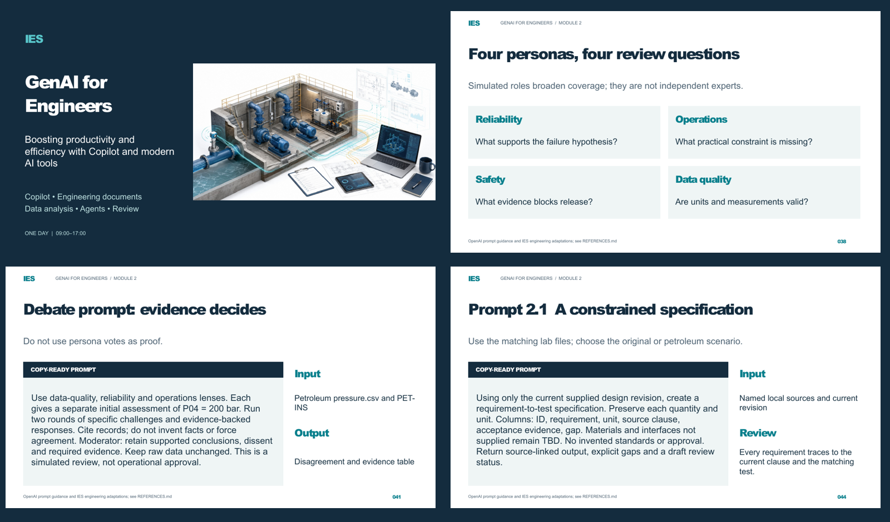
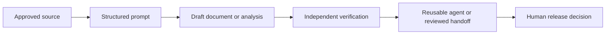

# IES GenAI for Engineers

Practical engineering documents, data analysis and reusable Copilot agents, with source verification and human review.




## Start here

1. Read the [Learner Guide](courseware/Learner-Guide/IES-GenAI-for-Engineers-Learner-Guide.docx).
2. Open the [editable PowerPoint](courseware/Slides/IES-GenAI-for-Engineers.pptx) or [slide PDF](courseware/Slides/IES-GenAI-for-Engineers.pdf).
3. Follow the [lab index](courseware/Labs/README.md). Each lab includes its own mock data, PDF handout, source reference PDF, copy-ready prompts, expected-output example and evidence template.
4. Refer to the [Lesson Plan](courseware/Lesson-Plan/IES-GenAI-for-Engineers-Lesson-Plan.docx) and [methodology quick references](courseware/Quick-References/).

## About

Training provider: **IES**. The package follows the supplied revised v2 GenAI for Engineers proposal and lesson plan, including PUB feedback. It retains six modules, seven learning outcomes, Primer 3.0 and all 16 labs. All engineering records are fictional classroom material, not operational instructions or published design standards.

The day runs 09:00–17:00. Excluding lunch and tea breaks, the timetable contains 390 instructional minutes; 300 minutes are allocated to labs. The source description of seven hours excluding lunch includes the tea breaks.

## What you will practise

- R.I.S.E. and E-MAP prompts for specifications, reports and planning documents.
- FMEA ratings and RPN, DMAIC reporting, Pareto analysis and introductory SPC.
- FMEA Assistant and Report Writer agents, Researcher and Analyst.
- SharePoint grounding, citation checks and controlled handoffs.
- Seven-step AI security review and a personal engineering AI toolkit.

## Petroleum enrichment — version 1.1

The petroleum engineering ebook informs 27 new visual slides and deeper explanations across all six modules. Every lab includes an alternative petroleum scenario, PDF handout, PDF data pack, original synthetic datasets, prompts and acceptance checks. Choose one scenario within the existing lab time.

Topics include data quality and units, predictive versus generative AI, equipment reliability, confusion matrices, forecast errors, retrieval provenance and environmental evidence. See the [ebook source mapping](courseware/Petroleum-Source-Mapping.md). The copyrighted ebook is retained locally and is not redistributed.

## Prompt engineering — version 1.2

Added 34 slides with activity prompts, benefits, RISE/E-MAP, concrete constraints, multiple personas, evidence-led debate and prompt evaluation. Every lab includes Prompt-Engineering.md/PDF and a comparison log. The expanded Learner Guide includes principles and per-lab prompt practice. See the [prompt playbook](courseware/Prompt-Engineering/Prompt-Engineering-Playbook.pdf). The one-day schedule is unchanged; select examples within the existing activities.

## Tools and prerequisites

A corporate Microsoft 365 account, active Microsoft 365 Copilot licence, Word, Excel, PowerPoint, Teams and SharePoint are required for the live labs. Agent creation, reasoning agents, sharing and training-site access depend on tenant policy. Confirm access before class. No prior FMEA, Six Sigma or SPC knowledge is assumed.

The content uses editable PowerPoint and Word files, PDF handouts, CSV mock datasets and Markdown prompts. There is no application install or API key requirement. Download this repository as a ZIP, extract it, and open the documents locally. Use approved paired access if needed; mark unavailable live capabilities as not executed.

## Workflow



## Package structure

```text
courseware/
  Slides/             166-slide editable deck and PDF
  Learner-Guide/      Detailed Word guide and Markdown overview
  Lesson-Plan/        Timed delivery plan
  Labs/               16 self-contained lab folders
  Quick-References/   FMEA, DMAIC and SPC one-page PDFs
  REFERENCES.md       Primary technical sources
assets/               Four generated engineering illustrations
```

## Teaching examples and actual results

Expected outputs are illustrative references, not recorded Copilot runs. The interactive agent chain is not a deployed scheduled workflow. Actual account access, agent deployment and permission tests must be demonstrated in the training tenant. The Facilitator Guide and original signed/source documents are supplied separately to the provider and are not in this learner repository.

## Publication and credits

Learning materials are distributed through this repository; there is no website or GitHub Pages deployment. The repository retains its existing private visibility. IES is the training provider. Engineering illustrations were generated with OpenAI imagegen; prompts and provenance are recorded in [assets/README.md](assets/README.md). Microsoft product names identify the tools taught. See [references](courseware/REFERENCES.md) for current navigation and statistical methods.

Visual corrections: five hub diagrams have connected lines and centered labels; seven conceptual image layouts use aligned cards; three diagrams correctly distinguish parallel streams or alternative verdicts. The 166-slide PPTX and PDF contain the same corrected layouts.
