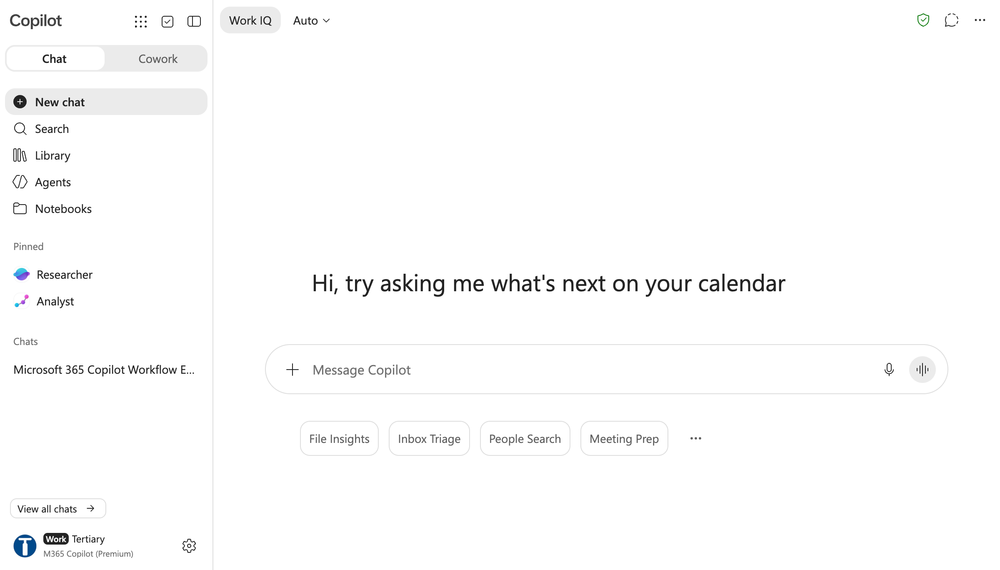
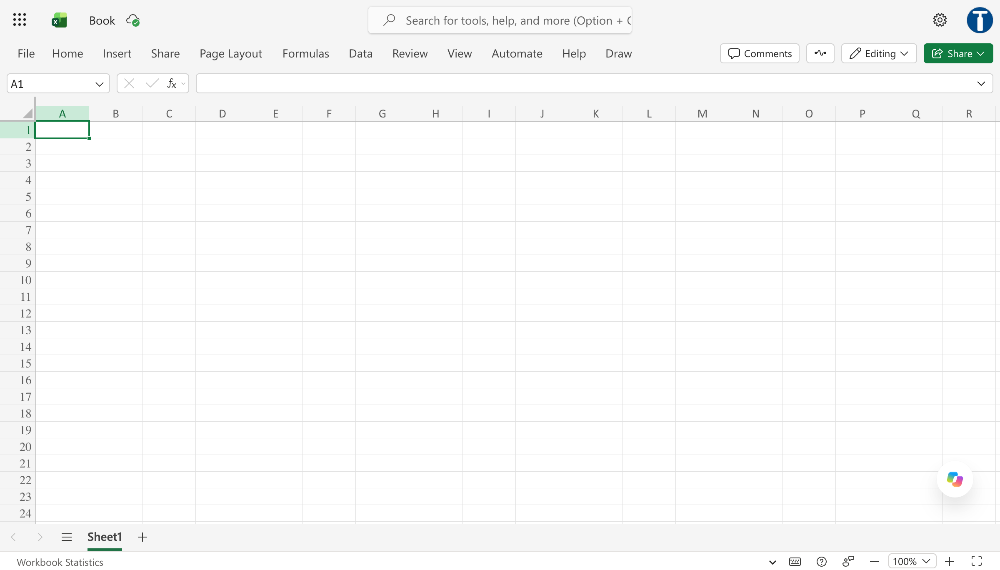

# Module 3: 65 minutes of guided Excel practice

- SPC: 25 minutes (11:45–12:10)
- FMEA: 20 minutes (12:10–12:30)
- DMAIC: 20 minutes (12:30–12:50)

Use one prepared worked workbook. No other labs are required. Starter workbooks and the full prompt bank are optional after-class resources.

## Open Microsoft 365 Copilot

- [Microsoft 365 Copilot](https://m365.cloud.microsoft/chat) — sign in with your work or school account.
- [Get started with Copilot in Excel](https://support.microsoft.com/en-us/office/get-started-with-copilot-in-excel) — Excel analysis help.
- [How Copilot Chat works in Microsoft 365 apps](https://support.microsoft.com/en-us/microsoft-365-copilot/how-copilot-chat-works-in-microsoft-365-apps) — Word, Excel and PowerPoint guidance.

If the Copilot button is missing, use the approved manual-formula fallback and tell the trainer. Availability depends on your organisation’s licence and settings.

## Interface reference screenshots

